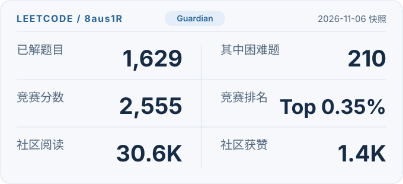

<h1>Hi, I'm zbz.</h1>

<strong>计算机科学与技术本科生 · 算法 / 数据库 / AI 工具</strong>

正在构建 MewCode，也在整理大学期间的算法笔记与数据库实践。

  <a href="https://github.com/8aus1R/MewCode"><strong>MewCode</strong></a>
  &nbsp; / &nbsp;
  <a href="https://github.com/8aus1R/algorithms-and-data-structures">算法笔记</a>
  &nbsp; / &nbsp;
  <a href="https://leetcode.cn/u/8aus1rchas1n0cl0ut/">LeetCode</a>

## Selected Projects · 代表项目

### [MewCode](https://github.com/8aus1R/MewCode)
**Python 命令行 AI Agent**

把多轮对话、工具调用和执行结果接成完整流程，探索权限控制、上下文管理与持久化记忆。项目仍在持续迭代。

`Python` · `Agent Loop` · `MCP`  
[源码与使用方法](https://github.com/8aus1R/MewCode) · [架构概览](https://github.com/8aus1R/MewCode/blob/main/docs/showcase/offline-cli.md#架构概览) · [本地命令实录](https://github.com/8aus1R/MewCode/blob/main/docs/showcase/offline-cli.md)

### [算法与数据结构](https://github.com/8aus1R/algorithms-and-data-structures)
**两年刷题留下的笔记、题解与代码**

从基础算法、树与图，到回溯和动态规划，记录解题思路、实现过程与复盘。整理了主题导航，也保留了学习中的疑问。

`C++` · `Data Structures` · `Problem Solving`  
[按主题阅读](https://github.com/8aus1R/algorithms-and-data-structures#按主题阅读) · [精选笔记 ↓](#selected-notes--精选笔记)

### [数据库系统竞赛实践](https://github.com/8aus1R/database-competition-projects)
**从存储、索引到查询执行**

围绕 RMDB 竞赛框架保存代码与学习笔记，整理 B+ 树、查询处理和优化的阅读路线，并记录 MiniOB 实践心得。

`C++` · `RMDB` · `Database Internals`  
[仓库与来源说明](https://github.com/8aus1R/database-competition-projects) · [数据库学习路线](./docs/database-reading-map.md)

### [Engineering Accreditation Skill](https://github.com/8aus1R/engineering-accreditation-skill)
**课程材料整理与核查工作流**

把成绩表核查、文档处理与交付验证中的步骤整理成可复用 Skill，配套辅助脚本和虚构示例。

`Python` · `Skill` · `Document Verification`  
[使用说明与示例](https://github.com/8aus1R/engineering-accreditation-skill)

其他实践：数据结构课程项目与 STM32

- [校园选课与成绩记录管理系统](https://github.com/8aus1R/student-grade-management-system)：通过命令行管理记录，在链表、AVL 树、哈希表和动态数组之间切换，使用模拟数据做学习演示。
- [STM32 自动浇花项目](https://github.com/8aus1R/STM32-flower)：传感器监测、水泵控制与 MQTT 通信的软硬件实践。

## Selected Notes · 精选笔记

- [前缀和 + 哈希表](https://github.com/8aus1R/algorithms-and-data-structures/blob/main/%E5%9F%BA%E7%A1%80%E7%AE%97%E6%B3%95/%E5%89%8D%E7%BC%80%E5%92%8C%2B%E5%93%88%E5%B8%8C%E8%A1%A8/%E5%89%8D%E7%BC%80%E5%92%8C%2B%E5%93%88%E5%B8%8C%E8%A1%A8.md) — 从「和为 K 的子数组」理解在线维护与计数。
- [从记忆化搜索到递推](https://github.com/8aus1R/algorithms-and-data-structures/blob/main/%E5%8A%A8%E6%80%81%E8%A7%84%E5%88%92/%E8%AE%B0%E5%BF%86%E5%8C%96%E6%90%9C%E7%B4%A2/%E8%AE%B0%E5%BF%86%E5%8C%96%E6%90%9C%E7%B4%A2.md) — 用打家劫舍串起递归、记忆化、递推与空间优化。
- [统计特殊三元组](https://github.com/8aus1R/algorithms-and-data-structures/blob/main/%E7%BB%8F%E5%85%B8%E9%A2%98%E9%A2%98%E8%A7%A3/%E5%BC%A0%E5%AE%9D%E6%B3%BD-%E5%8A%9B%E6%89%A3%E9%A2%98%E8%A7%A3-3583.%E7%BB%9F%E8%AE%A1%E7%89%B9%E6%AE%8A%E4%B8%89%E5%85%83%E7%BB%84%20%2041.0%25%20%E4%B8%AD%E7%AD%89.md) — 从暴力枚举到前后缀计数。

## Currently · 近况

大三，正在准备 11408。复习之余继续迭代 MewCode，整理算法与数据库笔记。考研期间刷题会少一些，但还会继续写下去。

## LeetCode · 长期积累

<a href="https://leetcode.cn/u/8aus1rchas1n0cl0ut/">
  <picture>
    <source media="(prefers-color-scheme: dark)" srcset="./assets/leetcode-2026-11-06-dark.svg" />
    
  </picture>
</a>

数据截至 **2026-11-06**，为静态快照。[查看当前力扣主页 →](https://leetcode.cn/u/8aus1rchas1n0cl0ut/)

---

[Bilibili](https://space.bilibili.com/68534484) · [Douyin](https://www.douyin.com/user/MS4wLjABAAAAfMMMAMkXDWRNCu_KtJq6urPe5G3LRhyK-oEYmwGsy9Q) · [GitHub](https://github.com/8aus1R)

