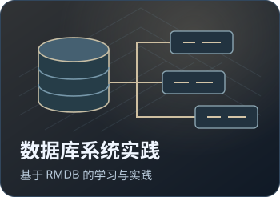

<h1>zbz</h1>

计算机科学与技术本科生

<strong>Algorithms &nbsp; / &nbsp; Database Systems &nbsp; / &nbsp; AI Agents</strong>

 

 

  <a href="https://github.com/8aus1R/MewCode/blob/main/docs/showcase/offline-cli.md">MewCode 命令实录</a>
  &nbsp; · &nbsp;
  <a href="./docs/database-reading-map.md">数据库学习路线</a>
  &nbsp; · &nbsp;
  <a href="https://github.com/8aus1R/STM32-flower">STM32</a>

 

<!-- GITHUB:START -->

<!-- GITHUB:END -->

  

<!-- LEETCODE:START -->

<a href="https://leetcode.cn/u/8aus1rchas1n0cl0ut/"><strong>Guardian &nbsp; · &nbsp; 2555 &nbsp; · &nbsp; Top 0.35%</strong></a>

<!-- LEETCODE:END -->

 

  <a href="https://space.bilibili.com/68534484">Bilibili</a>
  &nbsp; / &nbsp;
  <a href="https://www.douyin.com/user/MS4wLjABAAAAfMMMAMkXDWRNCu_KtJq6urPe5G3LRhyK-oEYmwGsy9Q">Douyin</a>
  &nbsp; / &nbsp;
  <a href="https://github.com/8aus1R">GitHub</a>

