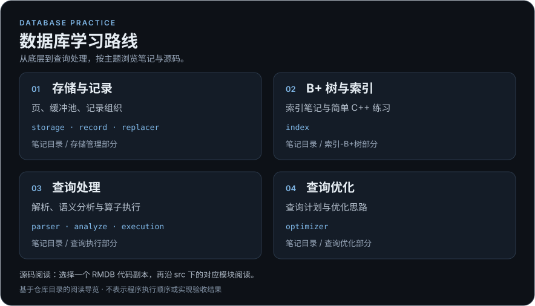

# 数据库学习路线

这张图根据仓库现有笔记目录与 RMDB 代码目录整理，只提供阅读入口。

- [存储与记录](https://github.com/8aus1R/database-competition-projects/tree/main/%E5%AD%98%E5%82%A8%E7%AE%A1%E7%90%86%E9%83%A8%E5%88%86) — 对照 `storage / record / replacer` 模块阅读。
- [B+ 树与索引](https://github.com/8aus1R/database-competition-projects/tree/main/%E7%B4%A2%E5%BC%95-B%2B%E6%A0%91%E9%83%A8%E5%88%86) — 对照 `index` 模块阅读。
- [查询处理](https://github.com/8aus1R/database-competition-projects/tree/main/%E6%9F%A5%E8%AF%A2%E6%89%A7%E8%A1%8C%E9%83%A8%E5%88%86) — 对照 `parser / analyze / execution` 模块阅读。
- [查询优化](https://github.com/8aus1R/database-competition-projects/tree/main/%E6%9F%A5%E8%AF%A2%E4%BC%98%E5%8C%96%E9%83%A8%E5%88%86) — 对照 `optimizer` 模块阅读。

[RMDB 代码副本](https://github.com/8aus1R/database-competition-projects/tree/main/%E6%8F%90%E4%BA%A4%E9%A1%B9%E7%9B%AE%E4%BB%A3%E7%A0%81) · [仓库内容与来源说明](https://github.com/8aus1R/database-competition-projects#来源与说明)

仓库保留四份 RMDB 代码副本；请选择其中一个目录阅读。这张图不判断哪份是最终版本，也不表示各模块已经通过实现验收。RMDB 框架来源及许可证以仓库原有说明为准。

